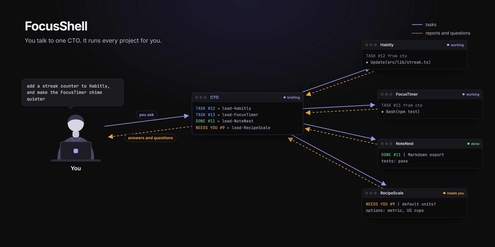

# FocusShell

## TL;DR

- One window for all your Claude Code projects: you talk to one CTO session, and it hands the
  work to a lead session in each project.
- Free and open source (GPL-3.0), for Windows 10 and 11 and Apple silicon Macs (macOS 14 or newer).
- Download `FocusShell-Setup-2.0.0.exe` from [Releases](https://github.com/ZazaGdev/FocusShell/releases) and run it. Windows may show a SmartScreen warning because the app is not code-signed yet: click **More info**, then **Run anyway**.
- On a Mac, download `FocusShell-2.0.0-arm64.dmg` instead; [Mac](#mac-apple-silicon-macos-14-or-newer) below says how to open it.

More on how it works: [zazag.dev/apps/focusshell](https://zazag.dev/apps/focusshell/)

[ Watch the demo](https://www.youtube.com/watch?v=t_WVO-hzF2w)

## Install

1. Download the installer from [Releases](https://github.com/ZazaGdev/FocusShell/releases).
2. Run it. It is not code-signed: if SmartScreen stops it, click **More info**, then **Run anyway**.
3. Open FocusShell and follow the short setup.

### Mac (Apple silicon, macOS 14 or newer)

1. Download `FocusShell-<version>-arm64.dmg` from [Releases](https://github.com/ZazaGdev/FocusShell/releases), open it and drag FocusShell to Applications.
2. Open FocusShell. It is not signed by Apple, so macOS stops it the first time: open
   **System Settings > Privacy & Security**, scroll down and click **Open Anyway**. (Or run
   `xattr -dr com.apple.quarantine /Applications/FocusShell.app` in Terminal.)
3. To check the download, compare `shasum -a 256 FocusShell-<version>-arm64.dmg` with the
   SHA-256 in the release notes.

Because the Mac version is not signed:

- It cannot update itself. It tells you when a new version is out and opens its download page.
- macOS asks again, after each update, for the permissions it uses: Microphone and Screen &
  System Audio Recording (the screen recorder), Input Monitoring (talk to the CTO from any app,
  hold Ctrl to draw) and Accessibility (the microphone button on a card starts Dictation). Turn
  them on in System Settings > Privacy & Security when it asks.
- For the screen recorder, install `ffmpeg` and `whisper-cpp` (`brew install ffmpeg whisper-cpp`)
  and put a Whisper model file (such as `ggml-small.en.bin`) in the Whisper folder named in
  Settings.

## Requirements

- [Claude Code](https://docs.claude.com/en/docs/claude-code) 2.1.234 or newer, signed in
- [Node.js](https://nodejs.org/en/download) 18 or newer, and Git
- Optional: VS Code, for the Code pane

## Network

FocusShell has no analytics. Everything that reaches Anthropic goes through your own Claude Code
sign-in and counts against your Claude plan: the sessions in your panes, and short headless
Claude Code turns FocusShell runs for you. Two of those run on their own, on Haiku: a plain
summary of each Waiting on you card (it sends the card's text), and Maybe missed, which reads the
CTO pane's own Claude Code log on your PC and asks about a message only when its own rules cannot
tell. The AI helper, catch-up recaps and the screen recorder's cards (a recording's transcript and
screenshots) run only when you use them. Transcription itself runs on your PC.

FocusShell checks this repo's Releases for updates, the Code pane downloads VS Code's web build
from Microsoft once (it asks first), and a project page lists its open pull requests through your
`gh` sign-in. Remote Control (your sessions on claude.ai) and pushing the board backup to its
remote are off unless you turn them on.

## Permissions

FocusShell adds no sandbox. Each pane is a normal Claude Code session in auto mode, started in
its project's folder, and Claude Code's permissions and your Claude Code settings decide what it
can reach. With Claude Code's defaults, a lead can still read files outside its folder, and
write there when its task asks for it, and every pane runs as your own user.
[FocusShell and Claude Code permissions](PERMISSIONS.md) explains what is and is not kept apart,
what FocusShell sets, and the Claude Code settings that make it stricter.

## Build from source

`cd app`, then `npm ci` and `npm run dist` (Windows), or `npm run dist:mac` on a Mac with
Xcode's command line tools.

## Licence

Copyright (C) 2026 Zaza Gejadze. GPL-3.0-or-later: you may share and change FocusShell, and any
version you distribute must stay open under the same licence; see [LICENSE](LICENSE). Bundled
parts keep their own licences, listed in [THIRD_PARTY_NOTICES.md](THIRD_PARTY_NOTICES.md).
FocusShell is not affiliated with or endorsed by Anthropic.
