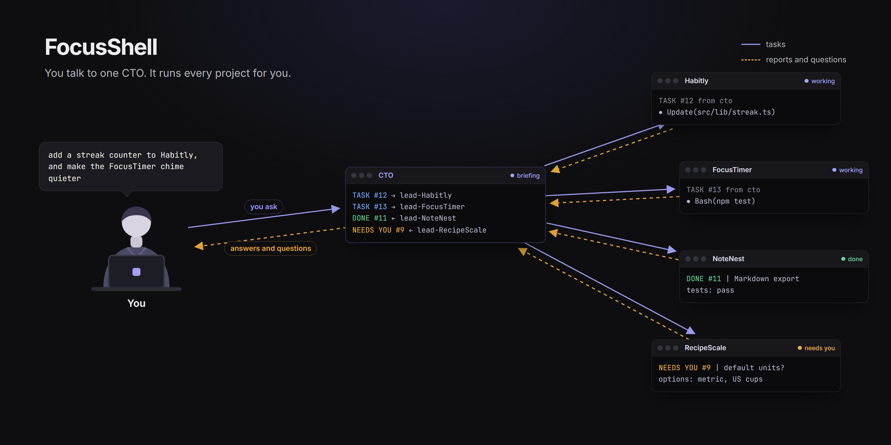

# FocusShell

## TL;DR

- One window for all your Claude Code projects: you talk to one CTO session, and it hands the
  work to a lead session in each project.
- Free and open source (GPL-3.0), for Windows 10 and 11. Mac support is coming soon.
- Download `FocusShell-Setup-1.0.0.exe` from [Releases](https://github.com/ZazaGdev/FocusShell/releases) and run it. Windows may show a SmartScreen warning because the app is not code-signed yet: click **More info**, then **Run anyway**.

More on how it works: [zazagdev.github.io/FocusShell](https://zazagdev.github.io/FocusShell/)

[ Watch the demo](https://www.youtube.com/watch?v=t_WVO-hzF2w)

## Install

1. Download the installer from [Releases](https://github.com/ZazaGdev/FocusShell/releases).
2. Run it. It is not code-signed: if SmartScreen stops it, click **More info**, then **Run anyway**.
3. Open FocusShell and follow the short setup.

## Requirements

- [Claude Code](https://docs.claude.com/en/docs/claude-code) 2.1.234 or newer, signed in
- [Node.js](https://nodejs.org/en/download) 18 or newer, and Git
- Optional: VS Code, for the Code pane

## Network

Sessions reach Anthropic through your own Claude Code. FocusShell has no analytics. It checks
this repo's Releases for updates, and the Code pane downloads VS Code's web build from
Microsoft once. Remote Control (your sessions on claude.ai) is off unless you turn it on.

## Build from source

`cd app`, then `npm ci` and `npm run dist`.

## Licence

Copyright (C) 2026 Zaza Gejadze. GPL-3.0-or-later: you may share and change FocusShell, and any
version you distribute must stay open under the same licence; see [LICENSE](LICENSE). Bundled
parts keep their own licences, listed in [THIRD_PARTY_NOTICES.md](THIRD_PARTY_NOTICES.md).
FocusShell is not affiliated with or endorsed by Anthropic.
